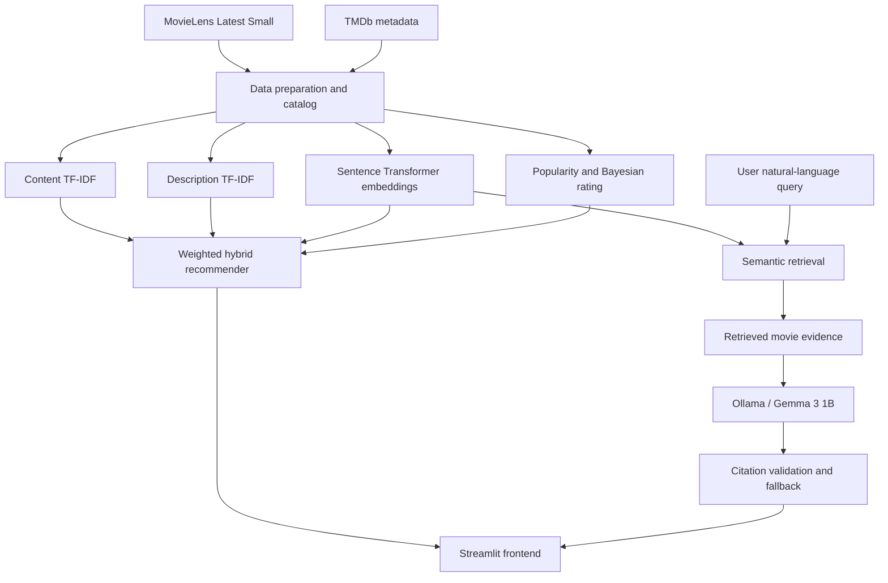

<div align="center">

# 🎬 CineMind AI

### An Intelligent Movie Recommendation System Powered by Hybrid Machine Learning and Retrieval-Augmented Generation

**Content-Based Filtering · Natural Language Processing · Semantic Search · RAG · Streamlit**

[](https://www.python.org/)
[](https://streamlit.io/)
[](https://scikit-learn.org/)
[](https://www.sbert.net/)
[](https://ollama.com/)

[Features](#-features) · [Architecture](#-system-architecture) · [Installation](#-getting-started) · [Evaluation](#-evaluation) · [Deployment](#-deployment-notes)

</div>

---

## 📌 Overview

**CineMind AI** is an applied machine learning project that combines a **hybrid movie recommendation engine** with a **conversational retrieval-augmented generation (RAG) assistant**. It helps users discover movies by browsing enriched metadata, selecting titles they enjoy, and describing preferences in natural language.

The recommendation engine combines lexical, semantic, popularity, and rating signals. Its AI assistant retrieves relevant records from a precomputed semantic index and asks a locally hosted language model to produce short, source-referenced recommendations. The project emphasizes end-to-end data preparation, model integration, explainable ranking, evaluation, and an interactive user interface.

> **Project status:** Functional local Streamlit prototype. Cloud deployment requires an accessible LLM service or a retrieval-only fallback, because the default Ollama endpoint runs on the developer's computer.

## ✨ Features

| Feature | Description |
|---|---|
| **Home and Explore** | Browse movie posters, metadata, descriptions, and recommendations. |
| **Trending / Top Rated / Genres** | Discover titles using stored TMDb popularity, rating, and genre metadata. These are catalog-based views, not live feeds. |
| **For You** | Generate preference-based suggestions from one or more selected movies using the hybrid model. |
| **AI Movie Assistant** | Ask natural-language questions and receive grounded recommendations from semantic retrieval plus an Ollama-hosted LLM. |
| **My Watchlist** | Save and remove movies during the current Streamlit session. |
| **Recommendation Insights** | Inspect hybrid scores and component similarities for recommendations. |
| **Model Performance** | Review saved retrieval and RAG evaluation outputs. |
| **About** | Explore the project architecture, methods, technologies, and limitations. |

## 🧠 Recommendation Methodology

CineMind AI uses a weighted hybrid ranking function that combines five signals:

| Component | Weight | Purpose |
|---|---:|---|
| Content-based TF-IDF | **30%** | Similarity from movie content-related features. |
| NLP TF-IDF | **20%** | Lexical similarity between descriptions. |
| Semantic embeddings | **35%** | Meaning-based similarity using Sentence Transformers. |
| TMDb popularity | **10%** | Normalized popularity signal. |
| Bayesian rating | **5%** | Rating-quality signal adjusted for vote counts. |

Conceptually:

```text
Hybrid score = 0.30 × Content
             + 0.20 × NLP
             + 0.35 × Semantic
             + 0.10 × Popularity
             + 0.05 × Bayesian Rating
```

The individual signals are processed by the project's recommendation pipeline before combination. **The resulting score is a ranking measure, not a calibrated probability that a user will enjoy a movie.**

### Semantic search and RAG

1. A user describes a movie preference in natural language.
2. `sentence-transformers/all-MiniLM-L6-v2` converts the query into an embedding.
3. The application compares the query with stored movie embeddings using cosine similarity.
4. Relevant movie metadata is assembled as retrieved evidence.
5. **Ollama / Gemma 3 1B** generates a concise answer grounded in that evidence.
6. Citation handling checks references to retrieved movie records and falls back to catalog suggestions when generation or validation fails.

Citation-format validation is **not** a guarantee of factual correctness; movie descriptions and generated claims should still be reviewed.

## 🏗️ System Architecture



## 📊 Datasets and Model Artifacts

| Asset | Scope |
|---|---|
| **MovieLens Latest Small** | Approximately **9,742** catalog movies, plus ratings and tags. |
| **TMDb-enriched catalog** | **500** movies with descriptions, genres, posters, and popularity/rating metadata. |
| **Content TF-IDF model** | Content representations for the broader MovieLens catalog. |
| **Description TF-IDF model** | Text representations for the enriched movie subset. |
| **Semantic embedding matrix** | **500 × 384** using `all-MiniLM-L6-v2`. |

Primary files include:

- `data/processed/movie_catalog.csv`
- `data/external/tmdb/tmdb_movies.csv`
- `models/content_tfidf.joblib`
- `models/nlp_tfidf.joblib`
- `models/semantic_embeddings.npz`

Only a subset of the wider MovieLens dataset has enriched descriptions and semantic embeddings; this limits the AI assistant's searchable coverage.

## 🛠️ Technology Stack

| Layer | Technologies |
|---|---|
| Language | Python 3.11 |
| UI | Streamlit, custom CSS |
| Data handling | Pandas, NumPy |
| Machine learning | scikit-learn, TF-IDF, joblib |
| Semantic NLP | Sentence Transformers, `all-MiniLM-L6-v2` |
| Generation | Ollama, Gemma 3 1B |
| Data | MovieLens Latest Small, TMDb metadata |
| Evaluation | Saved CSV reports, manual relevance review, retrieval and RAG tests |
| Version control | Git, GitHub |

## 📁 Project Structure

```text
CineMind-AI/
├── apps/
│   └── frontend/
│       ├── app.py                  # Streamlit entry point
│       ├── pages/                  # Application pages
│       ├── components/             # Reusable UI elements
│       └── assets/                 # Styles and images
├── src/
│   └── movie_recommender/
│       ├── data/                   # Catalog preparation and TMDb integration
│       ├── recommendation/         # Content, NLP, semantic and hybrid models
│       ├── retrieval/              # Semantic movie search
│       ├── llm/                    # Ollama RAG assistant
│       └── evaluation/             # Evaluation routines
├── data/
│   ├── raw/movielens/
│   ├── processed/
│   └── external/tmdb/
├── models/                         # Saved model artifacts
├── reports/
│   ├── eda/
│   └── evaluation/
├── scripts/                        # Tests and preparation scripts
├── tests/
├── .streamlit/config.toml
├── requirements.txt
├── .env.example
└── README.md
```

## 🚀 Getting Started

### Prerequisites

- **Python 3.11** (the version used for local development)
- **Git**
- An internet connection for first-time Sentence Transformers model download and TMDb poster images
- **Ollama** for locally generated AI Assistant answers
- Sufficient RAM to load the saved models, text encoder, and local language model

### 1. Clone the repository

```powershell
git clone https://github.com/SKAZAM6709/CineMind-AI.git
cd CineMind-AI
```

### 2. Create a virtual environment

**Windows PowerShell**:

```powershell
py -3.11 -m venv .venv
.\.venv\Scripts\Activate.ps1
```

On macOS/Linux, use `python3 -m venv .venv` and `source .venv/bin/activate`.

### 3. Install dependencies

```powershell
python -m pip install --upgrade pip
python -m pip install -r requirements.txt
```

**Dependency note:** Before a fresh installation or cloud deployment, verify that `requirements.txt` includes all packages used by the current implementation, notably `sentence-transformers`, `torch`, `requests`, `python-dotenv`, `scipy`, `pandas`, `numpy`, `scikit-learn`, `joblib`, `Pillow`, and `streamlit`. Earlier project revisions used a minimal Stage 1 requirements file.

### 4. Set up Ollama (AI Assistant)

Install Ollama from [ollama.com](https://ollama.com/), then pull the model:

```powershell
ollama pull gemma3:1b
```

Ensure Ollama is running on your computer. By default, the application uses:

```text
http://127.0.0.1:11434/api/generate
```

Without a reachable Ollama server, the AI Assistant can provide retrieval-based fallback recommendations, but not locally generated conversational responses.

### 5. Configure environment variables (if needed)

Create a local `.env` file from `.env.example` if your workflow uses TMDb API access. Never commit real API tokens. The pre-enriched CSV catalog is included for local exploration; fetching fresh TMDb metadata requires API credentials.

### 6. Run the application

From the **repository root**:

```powershell
python -m streamlit run apps/frontend/app.py
```

Open the local URL printed by Streamlit, commonly `http://localhost:8501`.

### 7. Run the RAG test

```powershell
python -m scripts.test_rag
```

This checks semantic movie retrieval and attempts an Ollama-generated, citation-validated answer. A successful generation prints `LLM generation successful: True`; an unsuccessful generation may return a grounded fallback.

## 📈 Evaluation

Evaluation artifacts are saved in `reports/evaluation/`, including retrieval review files and RAG evaluation outputs.

- **Retrieval relevance:** Manually reviewed recommendations and Precision@5 summaries.
- **RAG behavior:** Retrieval, generation success/failure, latency, and source-reference checks.
- **Explainability:** Inspection of component similarities and combined hybrid scores.

**Interpretation:** Early relevance review results were obtained on a smaller baseline index. They should **not** be reported as benchmark results for the current 500-movie system without rerunning the evaluation. The project is an engineering prototype, not a validated production recommender.

## ☁️ Deployment Notes

The Streamlit application entry point is:

```text
apps/frontend/app.py
```

To deploy with [Streamlit Community Cloud](https://share.streamlit.io/):

1. Push the repository and required model/data assets to GitHub.
2. Confirm all runtime dependencies are listed in `requirements.txt`.
3. Create an app from the GitHub repository and select `apps/frontend/app.py`.
4. Check memory usage and model loading in the deployment logs.
5. Configure a reachable hosted LLM endpoint **or** explicitly use retrieval-only fallback mode.

> **Important:** A cloud-hosted Streamlit app cannot call Ollama on your personal computer through `127.0.0.1`. No public live-demo URL is claimed here until deployment is completed and tested.

## ⚠️ Limitations and Future Improvements

- The semantic search index currently covers **500 enriched movies**, rather than the full MovieLens catalog.
- TMDb popularity and ratings are stored snapshots; discovery views do not represent real-time trends.
- The watchlist uses Streamlit session state and is not stored in a persistent user database.
- Small local LLMs may be slow on CPU hardware and can occasionally omit citations or generate unsupported details.
- The system's hybrid weights are configured values, not statistically proven optimal weights.
- Evaluation results from the smaller baseline should not be generalized to the expanded index.
- Potential future work includes faster response streaming, hosted inference, richer preference feedback, broader indexing, reranking experiments, and persistent user profiles.

## 📚 Data Attribution

- **MovieLens:** [GroupLens Research](https://grouplens.org/datasets/movielens/) — subject to the dataset's terms and license.
- **TMDb:** [The Movie Database](https://www.themoviedb.org/) — movie metadata and imagery. **This product uses the TMDB API but is not endorsed or certified by TMDB.**

Review the applicable dataset and API licenses before reuse, redistribution, or commercial deployment.

## 👨‍💻 Project Information

**Project:** CineMind AI — RAG-Based Intelligent Movie Recommendation System  
**Focus:** Applied Machine Learning, Recommender Systems, NLP, Semantic Retrieval, and LLM Integration  
**Repository:** [github.com/SKAZAM6709/CineMind-AI](https://github.com/SKAZAM6709/CineMind-AI)

---

<div align="center">

**CineMind AI — Discover movies through data, semantics, and intelligent recommendations.**

</div>
